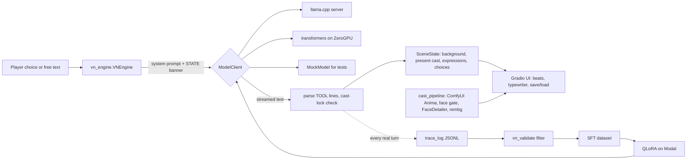

# Ars Fabula VN

**An anime visual novel where a local LLM writes every scene live and drives the
stage (sprites, expressions, backgrounds, choices) through a plain-text tool
protocol, with a ComfyUI pipeline that generates the cast's sprites on demand.**

Built for the Hugging Face *Build Small* hackathon (Thousand Token Wood track).
The scene writer runs on an 8 GB GPU at home and on a Hugging Face ZeroGPU
Space in the hosted version.

[](https://www.youtube.com/watch?v=0adUvKaqERM)

*Demo video (YouTube). Click the image to watch.*

## Why it is interesting

- **Tool calling without a function-calling API.** The model emits lines like
  `[TOOL: set_expression character="Rin" expression="smile"]`. Seven tools
  (`advance_scene`, `set_background`, `set_expression`, `enter_character`,
  `exit_character`, `offer_choices`, `save_checkpoint`) are parsed out of plain
  text, so any small instruct model can drive the UI. The parser is tolerant of
  what real models actually produce (unquoted JSON keys, Python-style
  single-quoted values, apostrophes inside quoted strings) and works line by
  line on a token stream, so the stage updates while the scene is still being
  written.
- **Cast-lock.** The model may only use characters that have sprites. The engine
  detects invented names, replaces their dialogue with a neutral narration line,
  and flags the violation instead of rendering a character that does not exist.
- **One engine, three model backends.** `ARS_FABULA_BACKEND` picks an
  OpenAI-compatible server (llama.cpp), an in-process `transformers` model (for
  ZeroGPU, where only the main process can hold the GPU), or a scripted mock for
  tests. The engine only sees the `ModelClient` interface.
- **Generated cast with stable identity.** `cast_pipeline.py` drives a ComfyUI
  graph: Anima base image, a face-detector gate that retries on a miss, then a
  FaceDetailer pass per expression that regenerates only the face, so body and
  clothes stay identical across all seven expressions. `rembg` (isnet-anime)
  cuts the alpha sprite. The same workflow runs over HTTP against a ComfyUI
  subprocess at home, or in-process inside `@spaces.GPU` calls on ZeroGPU
  (`comfy_embed.py`).
- **GPU juggling on 8 GB.** The LLM and the diffusion stack do not fit together
  on the dev machine's card, so the app stops the LLM server, bakes the images,
  and relaunches it (`model_client.py`, VRAM lifecycle section).
- **A fine-tuning loop built from the game itself.** Every real turn is logged
  in SFT chat format (`trace_log.py`). `vn_validate.py` is the single definition
  of a well-formed turn and is reused as the dataset filter and as the eval
  metric. The tools turn traces and external VN text into a validated dataset,
  run a QLoRA fine-tune on Modal with the loss masked to assistant tokens, and
  score held-out generations.

## Architecture



| File | Role |
|---|---|
| `vn_engine.py` | Turn loop: prompt, model call, streamed tool parsing, cast-lock, scene mutation, saves |
| `vn_prompt.py` | System prompt and the per-turn `[STATE]` banner |
| `vn_contracts.py` | Data shapes shared by every module (`SceneState`, `CastMember`, `Choice`) |
| `vn_validate.py` | One definition of a valid turn, used for dataset filtering and eval |
| `model_client.py` | `ModelClient` backends and the LLM server start/stop lifecycle |
| `cast_pipeline.py`, `comfy_embed.py` | Sprite generation over HTTP or in-process ComfyUI |
| `providers.py` | Background providers (preset or live txt2img) and optional voice hooks |
| `ui/` | Gradio layout, CSS, beat pacing and callbacks |
| `tools/` | Model launchers, Space deploy, dataset building, Modal training, eval, sampler A/B scripts |

## Results

- **Fine-tuned model:** a QLoRA tune of Gemma 4 26B-A4B on the MoE experts,
  published as
  [build-small-hackathon/Gemma-26B-A4B-VisualNovel-GGUF](https://huggingface.co/build-small-hackathon/Gemma-26B-A4B-VisualNovel-GGUF).
  Its model card reports, on held-out scenes: 100% protocol validity (48 of 48
  scenes, checked with `vn_validate`), type-token ratio 0.49 to 0.53, and
  cross-scene trigram reuse 0.019 to 0.004 against the untuned base. The card
  notes the caveat that the base was sampled once at a different temperature.
- **Local inference speed:** stock llama.cpp with MTP speculative decoding, MoE
  experts on CPU and `--no-mmap` measured 29.9 tokens/s for the 26B-A4B model on
  the dev machine, against about 4 tokens/s with mmap (benchmark notes in
  `tools/start_gemma_server_stock.sh`).
- **Tests:** 116 deterministic tests (unit and mock-engine tiers) run with no
  model server and no GPU.

## Run it

Mock mode needs no model and no GPU, and is the quickest way to see the UI and
the engine:

```bash
python -m venv .venv && source .venv/bin/activate
pip install gradio==6.16.0 requests pillow numpy pytest
ARS_FABULA_BACKEND=mock python app.py     # http://127.0.0.1:7861
pytest -m "not live"                      # 116 tests, no server needed
```

With a real model (the full `requirements.txt` also pulls the ComfyUI and
ZeroGPU dependencies):

```bash
pip install -r requirements.txt
bash tools/start_gemma_server_stock.sh &   # llama.cpp + Gemma 4 26B-A4B, port 8110
python app.py
```

Model and binary paths are read from `ARS_FABULA_LLAMA_*` environment variables
(see the header of `tools/start_gemma_server_stock.sh` and `model_client.py`).
Live sprite generation needs a ComfyUI install with the Anima model and
Impact-Pack; the custom nodes are pinned as git submodules under `third_party/`.

Hugging Face deployment: `tools/deploy_space.sh` (Docker Space on a T4) or
`tools/deploy_space.sh --zerogpu` (Gradio Space). The Space cards live in
`.space-docker/` and `.space-zerogpu/`.

## Limitations

- Sprites and backgrounds are generated assets and are not in git. A fresh clone
  renders placeholder sprites until ComfyUI generates a cast.
- The default launcher paths in `model_client.py` and the `tools/` scripts point
  at the author's WSL machine. They are all overridable by environment variable,
  but there is no one-command local setup for the real model.
- The voice providers (Kokoro, Chatterbox) are optional hooks that expect a
  local TTS server; they are not part of the hosted demo.
- The story text is English only. The model card's own qualitative read: comedy
  and cast chemistry are the strong suit, romance scenes are the weak one.
- The hosted Spaces need ZeroGPU hardware and are not always running; the demo
  video is the reliable way to see the real-model experience.
